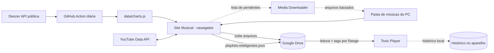
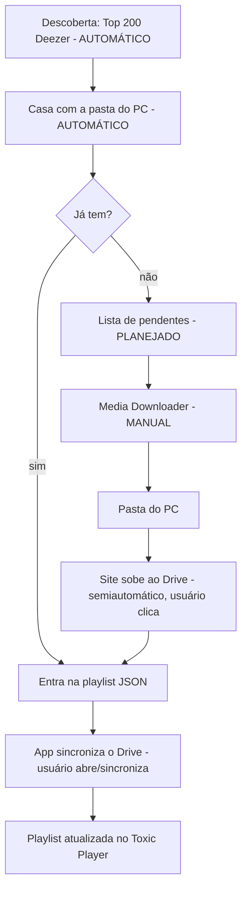
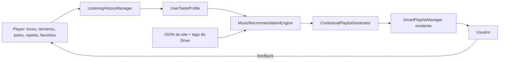

# ARCHITECTURE — arquitetura compartilhada (proposta)
Princípio: sem backend. O Google Drive é a ponte. Dados em JSON simples.

## Diagrama 1 — Arquitetura (sólido = existe, tracejado = planejado)


## Diagrama 3 — Caminho de uma música


## Diagrama 5 — Playlists inteligentes (PLANEJADO, nada disso existe ainda)

Regras: pular não é rejeição definitiva; nunca remover música manual; sem duplicata; histórico só no aparelho; explicar o motivo da sugestão.

## Contrato de dados (REAL, usar este)
```json
{ "formato": "toxic-playlists", "v": 2, "gerado": "ISO-8601",
  "playlists": [ { "nome": "…", "origem": "Deezer",
    "regra": { "tipo": "lista", "itens": [ { "t": "título", "a": "artista" } ] },
    "faixas": [ { "id": "opcional", "fn": "arquivo.mp3", "p": "pasta", "t": "título", "a": "artista" } ] } ] }
```
Casamento no app: 1º `id`, 2º `fn`, 3º título+artista normalizados.
Mudanças futuras devem manter `v:2` legível (campos novos opcionais).

## Diagramas 2, 4, 6, 7
Adiados: dependem de confirmar build e de decisões abaixo. Ver NEXT_AGENT_PROMPT.md.
